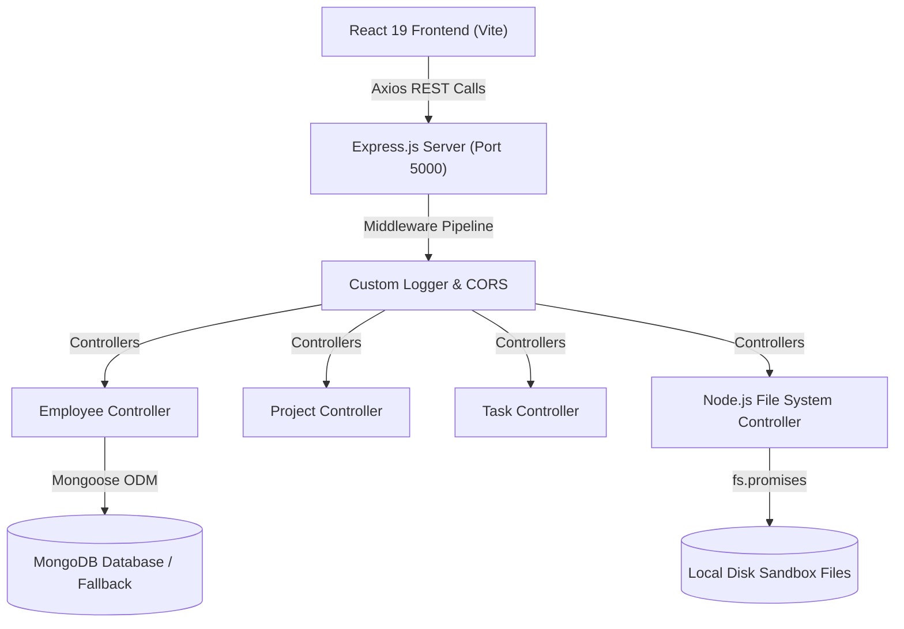

# 🚀 TeamFlow ERP – Employee, Project & Task Management System
### Full-Stack MERN Application aligned with 60-Hour Academic Syllabus (Units 1 - 5)

---

## 📌 Project Overview
**TeamFlow ERP** is a modern, enterprise-grade full-stack application engineered strictly in alignment with the academic **React + Node.js + Express + MongoDB (MERN)** curriculum. It serves as both a real-world enterprise management tool and an interactive academic viva/practical demonstration platform.

---

## 🎯 Syllabus Mapping (Unit 1 to Unit 5)

| Unit | Syllabus Module | Hours | Implemented Features & Code Locations |
| :--- | :--- | :---: | :--- |
| **Unit 1** | **Introduction To React Fundamentals** | 12 hrs | • First React App with Vite & JSX expressions<br>• Dynamic class rendering (`badge-success`, `badge-danger`)<br>• Functional Components & Props passing<br>• List rendering with unique keys & conditional rendering (`&&`, ternary)<br>• Controlled Forms (`src/pages/Employees.jsx`, `src/pages/SyllabusLab.jsx`) |
| **Unit 2** | **Role Of React Router And Hooks** | 12 hrs | • `BrowserRouter`, `Routes`, `Route`, `NavLink` with active states (`src/components/Navbar.jsx`, `src/App.jsx`)<br>• Lazy Routing (`React.lazy` & `<Suspense>`)<br>• **All 7 React Hooks**: `useState`, `useEffect`, `useContext`, `useReducer`, `useCallback`, `useMemo`, `useRef`<br>• **Redux Alternative Pattern**: `useReducer + useContext` global store (`src/context/AppContext.jsx`) |
| **Unit 3** | **RESTful API Calling With React JS** | 12 hrs | • Axios library integration with error handling<br>• Full CRUD: Calling `GET`, `POST`, `PUT`, `DELETE` APIs<br>• Interactive REST Inspector (`src/pages/SyllabusLab.jsx` - Unit 3 Tab)<br>• Form handling with live JSON API communication |
| **Unit 4** | **Introduction to Node.js & Core File System** | 12 hrs | • Node.js runtime environment and HTTP server architecture<br>• Asynchronous programming: Callbacks, Promises, and `async/await`<br>• **Node.js `fs` Module**: `fs.promises.writeFile`, `readFile`, `appendFile`, `unlink`<br>• **Sync vs Async Benchmark**: Compares `fs.readFileSync` vs `fs.promises.readFile` (`backend/controllers/nodeFsController.js`, `src/pages/Reports.jsx`) |
| **Unit 5** | **Building RESTful APIs with Node & Express** | 12 hrs | • REST principles, HTTP methods (`GET`, `POST`, `PUT`, `DELETE`, `PATCH`), and Status Codes (`200`, `201`, `400`, `404`, `500`)<br>• Express Middleware chain & custom request logger with elapsed ms<br>• Centralized Error Handling middleware (`backend/middleware/errorHandler.js`)<br>• **MongoDB & Mongoose**: Schemas, validations, types, timestamps, and virtuals<br>• **Select Command (Projections)**: `Model.find().select('fields')` demo<br>• **MongoDB Aggregation Pipeline**: `$group`, `$sum`, `$avg` department analytics (`backend/controllers/employeeController.js`) |

---

## 🛠️ Architecture & Tech Stack



---

## 🚀 How to Run Locally

### 1. Backend Server
```bash
cd backend
npm install
node server.js
```
> Running at: **`http://localhost:5000`**

### 2. Frontend Application
```bash
cd frontend
npm install
npm run dev
```
> Running at: **`http://localhost:5173`**

---

## 📡 REST API Endpoints Overview

| Method | Endpoint | Description | Unit Covered |
| :--- | :--- | :--- | :---: |
| `GET` | `/api/health` | System health, DB connection status, syllabus overview | Unit 5 |
| `GET` | `/api/employees` | Get all employees (supports `?search=`, `?department=`, `?select=`, `?sortBy=`) | Unit 3 & 5 |
| `POST` | `/api/employees` | Create employee record (with validation) | Unit 3 & 5 |
| `PUT` | `/api/employees/:id` | Update employee record | Unit 3 & 5 |
| `DELETE` | `/api/employees/:id` | Delete employee record | Unit 3 & 5 |
| `GET` | `/api/employees/stats/analytics` | MongoDB Aggregation pipeline ($group by dept, $avg salary) | Unit 5 |
| `GET` | `/api/projects` | List all enterprise projects | Unit 3 |
| `PATCH` | `/api/projects/:id/progress` | Live progress slider update | Unit 3 |
| `GET` | `/api/tasks` | Get tasks for Kanban board | Unit 2 & 3 |
| `POST` | `/api/tasks` | Create new task (dispatched via useReducer) | Unit 2 & 3 |
| `PATCH` | `/api/tasks/:id` | Transition task status (Todo -> In Progress -> Review -> Done) | Unit 2 |
| `POST` | `/api/node-fs/write` | Write file asynchronously (`fs.promises.writeFile`) | Unit 4 |
| `GET` | `/api/node-fs/read` | Read file asynchronously (`fs.promises.readFile`) | Unit 4 |
| `POST` | `/api/node-fs/append` | Append content (`fs.promises.appendFile`) | Unit 4 |
| `DELETE`| `/api/node-fs/delete` | Delete file (`fs.promises.unlink`) | Unit 4 |
| `GET` | `/api/node-fs/benchmark`| Sync vs Async I/O timing benchmark on server | Unit 4 |
